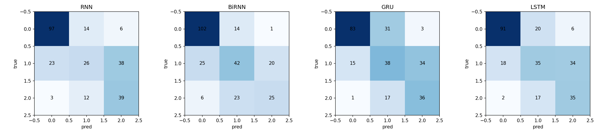
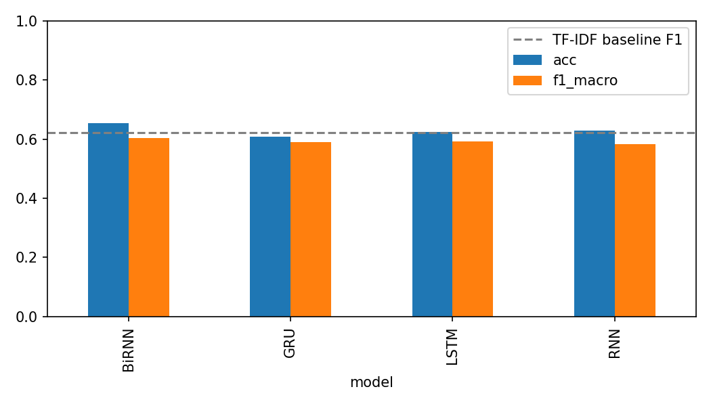

# Lab 3 — Deep Learning: relevance classification (RNN / GRU / LSTM) and GPT-2 text generation

**Topic:** education in Morocco (Arabic texts)  
**Master MBD — Deep Learning — Pr. Elaachak Lotfi — FST Tanger**

**Part 1:** RNN, Bidirectional RNN, GRU, LSTM (PyTorch) compared with a TF-IDF + logistic regression baseline  
**Part 2:** fine-tuning of a pretrained GPT-2 model on a custom corpus and text generation
**Environment:** Kaggle notebooks (GPU), Python, PyTorch, scikit-learn, NLTK, BeautifulSoup

---

# PART 1 — Classification

## 1. Objective

Collect Arabic texts about one topic (education in Morocco), give each text a relevance score between 0 and 10, apply an NLP preprocessing pipeline, train four recurrent architectures with tuned hyper-parameters, and evaluate them with standard metrics and BLEU.

## 2. Dataset

### 2.1 Collection

Texts were collected in two ways:

* **News articles** scraped with `requests` + `BeautifulSoup` from **Hespress** and **Al3omk**, in three tiers according to the section they were filed under:
  * *education* (tags: education, school year, university),
  * *near-topic* (politics, society), which gives ambiguous cases,
  * *unrelated* (sport, economy, culture).
* **Arabic Wikipedia** passages (via the Wikipedia API), cut into chunks of about 250 words, for education pages, near-topic pages (youth, family, public health, internet, labour market) and unrelated pages (football, tourism, cinema, agriculture...).

| Source | Education tier | Near-topic tier | Unrelated tier | Total |
|---|---|---|---|---|
| Hespress | 96 | 70 | 110 | 276 |
| Al3omk | 40 | — | 33 | 73 |
| Wikipedia | 39 | 20 | 42 | 101 |
| **Total** | **175** | **90** | **185** | **450** |

### 2.2 Relevance score (0–10)

The score is **not** a keyword count, so that the models cannot succeed just by counting words:

```
Score = 10 × calibrated( 0.8 × semantic similarity + 0.2 × source prior )
```

* **Semantic similarity:** cosine similarity between the multilingual sentence embedding (`paraphrase-multilingual-MiniLM-L12-v2`) of the first 256 words of the text and the mean embedding of five Arabic descriptions of the topic (education reform, schools and teachers, university, school year and exams, pedagogy).
* **Source prior:** 1.0 for the education tier, 0.4 for near-topic, 0.0 for unrelated.
* The result is rescaled on the 2nd–98th percentile to use the whole 0–10 range.

**Manual verification.** I read 40 borderline texts (scores 3–5 and 7–9) and corrected **20 texts** by hand. Typical corrections: texts filed under "education" that are not about education (a protest in France, a shooting at a US university), and political or administrative news that scored too high. In addition, Wikipedia near-topic pages (family, youth, public health, internet) were capped at 3.5, because they are not about education. Duplicate texts were removed.

### 2.3 Discretization

The continuous score was converted into three ordered classes:

| Class | Meaning | Score range | Texts |
|---|---|---|---|
| 0 | not relevant | < 4 | 220 |
| 1 | medium | 4 – 7.9 | 136 |
| 2 | very relevant | ≥ 8 | 94 |

### 2.4 Train / validation / test split

The split was made **before any modelling** and **by source group** (all chunks of one Wikipedia page stay in the same split), to avoid leakage between train and test.

| Split | Class 0 | Class 1 | Class 2 | Total |
|---|---|---|---|---|
| Train | 150 | 88 | 63 | 301 |
| Validation | 31 | 19 | 13 | 63 |
| Test | 39 | 29 | 18 | 86 |

## 3. Preprocessing pipeline

1. **Arabic normalization:** removal of diacritics and tatweel; unification of alef forms (أ إ آ → ا), yaa (ى → ي) and taa marbuta (ة → ه); collapse of letters repeated 3+ times; removal of non-Arabic characters and digits.
2. **Tokenization:** whitespace tokenization on the normalized text.
3. **Stop-word removal:** NLTK Arabic list (normalized the same way) plus a few domain-specific words (e.g. names of the news site, frequent reporting verbs).
4. **Stemming:** NLTK `ISRIStemmer`.
5. **Lemmatization:** `qalsadi`.
6. **Discretization** of the score (section 2.3).

Three versions of every text are stored (`tokens`, `stems`, `lemmas`). The models use the **stems**. After preprocessing, a text has on average 342 tokens (median 255, maximum 2,251); sequences are truncated to 256 tokens. The vocabulary (built on the training set only, minimum frequency 2) has 3,647 entries.

## 4. Models and training protocol

All four models share one PyTorch class, so that the comparison is fair:

```
Embedding → RNN / BiRNN / GRU / LSTM → masked max-pooling over time → Dropout → Linear (3 classes)
```

* **Loss:** cross-entropy weighted by class frequency (the classes are imbalanced).
* **Optimizer:** AdamW, gradient clipping at 1.0, early stopping (patience 6) on **validation macro-F1**.
* **Hyper-parameter tuning:** random search, 8 configurations per architecture, over embedding size {64, 128, 200}, hidden size {64, 128, 256}, number of layers {1, 2}, dropout {0.2, 0.3, 0.5}, learning rate {1e-3, 5e-4, 3e-4}, weight decay {0, 0.01}, batch size {16, 32}. The best configuration is chosen on the validation set.
* **Final evaluation:** the best configuration of each model is retrained with **3 different seeds** and evaluated **once on the test set**; results are reported as mean ± standard deviation.
* **Baseline:** TF-IDF (unigrams + bigrams) with a class-balanced logistic regression.

**Metrics:** accuracy, macro-F1, weighted-F1, ordinal mean absolute error (the classes are ordered, so predicting 0 for a class-2 text is worse than predicting 1), and BLEU.

> **About BLEU.** BLEU compares n-gram overlap between *sequences*, while a classifier predicts one label per text. It was computed as asked by the lab on label sequences (the shuffled test texts are cut into chunks of 10; the reference is the true label sequence and the hypothesis is the predicted one). It depends on the shuffle and the chunk size and is not a reliable quality measure here; macro-F1 and ordinal MAE are the metrics that should be trusted.

## 5. Results

### 5.1 Hyper-parameter search

Validation macro-F1 varied a lot between configurations (from about 0.22 to about 0.8). Very poor results came mostly from small models with 2 layers and a dropout of 0.5, which learn slowly with so little data. The best configurations tended to use a low learning rate (3e-4) and low dropout (0.2). The full search is in `hparam_search.csv`.

### 5.2 Test results (mean ± std over 3 seeds, 86 test texts)

| Model | Accuracy | Macro-F1 | Weighted-F1 | Ordinal MAE | BLEU |
|---|---|---|---|---|---|
| RNN | 0.628 ± 0.071 | 0.583 ± 0.064 | 0.611 ± 0.066 | 0.407 ± 0.081 | 0.373 ± 0.012 |
| **BiRNN** | **0.655 ± 0.029** | **0.604 ± 0.040** | **0.644 ± 0.033** | **0.372 ± 0.042** | **0.443 ± 0.047** |
| GRU | 0.609 ± 0.041 | 0.589 ± 0.047 | 0.612 ± 0.039 | 0.407 ± 0.065 | 0.414 ± 0.053 |
| LSTM | 0.624 ± 0.029 | 0.593 ± 0.019 | 0.623 ± 0.021 | 0.407 ± 0.035 | 0.387 ± 0.031 |
| *TF-IDF + LogReg (baseline)* | *0.628* | *0.623* | — | *0.372* | *0.405* |

Per-class results of one LSTM run (seed 0):

| Class | Precision | Recall | F1 | Support |
|---|---|---|---|---|
| not relevant | 0.82 | 0.85 | 0.84 | 39 |
| medium | 0.52 | 0.41 | 0.46 | 29 |
| very relevant | 0.48 | 0.61 | 0.54 | 18 |

Figures: confusion matrix of each model (summed over the 3 seeds), then accuracy and macro-F1 with the baseline as a dashed line.





## 6. Discussion

1. **No architecture clearly wins.** BiRNN has the best mean scores, but its lead (about 0.01–0.02 macro-F1) is smaller than the standard deviation across seeds (0.02–0.06). The honest conclusion is that the four architectures are statistically indistinguishable on this dataset.
2. **Gated units (GRU, LSTM) do not beat the simple RNN** here. This is plausible: texts are truncated to 256 tokens, the max-pooling over time gives the vanilla RNN a short path to the important words, and gradient clipping stabilises it, so the long-range memory of GRU and LSTM brings little. The bidirectional RNN has a small advantage in mean accuracy, but this is within the noise.
3. **The baseline is as good as the neural models.** TF-IDF + logistic regression reaches 0.623 macro-F1, slightly above every recurrent model. With about 300 training texts, recurrent networks with randomly initialized embeddings cannot exploit their extra capacity.
4. **Validation was optimistic.** Some configurations reached about 0.7–0.8 validation macro-F1, but the test macro-F1 is about 0.59. With only 63 validation texts, choosing the best of 8 configurations overfits the validation set (selection bias). Validation and test sets this small also make every number noisy.
5. **The medium class is the hardest** (F1 = 0.46 against 0.84 for "not relevant"). This is expected: it is the class where the labels are the most ambiguous (articles that touch education without being about it), and the boundaries (4 and 8) are arbitrary cuts of a continuous score.
6. **BLEU** follows roughly the same ordering as accuracy but carries little information; it is shown only because the lab requires it.

## 7. Limitations

* Small dataset (450 texts) and small validation and test sets: results are noisy and differences between models are not significant.
* The scores are **weak supervision** (embedding similarity + source + manual correction of 20 texts), not human ground truth. A model trained on them partly learns to imitate the embedding model.
* Style differences between sources (encyclopedic Wikipedia vs. news) can correlate with the label; the group split reduces this problem but does not remove it.
* The score is computed on the first 256 words of each text only.
* Embeddings are learned from scratch on a very small corpus.

## 8. Possible improvements

* Initialize the embeddings with pretrained Arabic vectors (fastText, AraVec) or fine-tune an Arabic transformer.
* More data, especially more "medium" articles, and a second human annotator to measure label agreement.
* Cross-validation (e.g. 5 folds) instead of a single small validation set, and more search trials.
* Compare the `stems`, `lemmas` and raw `tokens` versions of the text (already stored in the dataset).
* Evaluate bidirectional GRU and LSTM variants, which were not included in the four required models.

# PART 2 — Transformer: fine-tuning GPT-2 and text generation

## 9. Objective and setup

Fine-tune a pretrained GPT-2 model on a customized dataset, then generate a new paragraph from a given sentence (the tutorial recommended in the lab statement was followed in spirit: tokenization into fixed-size blocks, AdamW with warm-up, language-modelling loss).

* **Library:** `transformers` (the successor of `pytorch-transformers`, same API for loading and training GPT-2).
* **Model:** `aubmindlab/aragpt2-base`, a model with the **GPT-2 architecture (12 layers, about 135M parameters) pretrained on Arabic text**. The original English `gpt2` was not used because fine-tuning it on about 30,000 Arabic words would not produce usable Arabic.
* **Hardware:** Kaggle GPU, mixed precision (fp16).

## 10. Customized dataset

The corpus was generated from the dataset built in Part 1: **only the texts of class 2 ("very relevant") of the training split**, i.e. texts that are really about education.

| | Texts | Words | Blocks of 256 tokens |
|---|---|---|---|
| Training corpus | 63 | 29,761 | 165 |
| Validation (class 2, validation split) | 13 | — | 36 |

Texts are cleaned (whitespace), separated by the end-of-text token, concatenated and cut into blocks of 256 tokens. The validation texts were kept aside to measure perplexity. The corpus is saved as `education_corpus.txt`.

## 11. Fine-tuning

* Optimizer AdamW (learning rate 5e-5, weight decay 0.01), linear warm-up over 10 % of the steps then linear decay, gradient clipping at 1.0.
* 4 epochs, batch size 4, language-modelling (next-token) loss, mixed precision.

| Epoch | Train loss | Validation perplexity |
|---|---|---|
| before fine-tuning | — | **134.4** |
| 1 | 7.196 | 92.7 |
| 2 | 5.535 | 77.5 |
| 3 | 5.076 | 71.1 |
| 4 | 4.862 | **69.8** |

Validation perplexity on the education texts almost **halves (134.4 → 69.8)**, which means the model has adapted to the vocabulary and style of the education corpus. The first-epoch training loss (7.2) is an average that includes unstable first steps at the peak learning rate with fp16 (PyTorch also warns that the scheduler stepped before the optimizer for the first batch); the model recovered and the validation perplexity improved at every epoch. The perplexity is measured on only 36 blocks (13 texts), so it is a rough indicator.

## 12. Text generation

Generation settings: sampling with top-k 50, top-p 0.95, temperature 0.9, repetition penalty 1.2, no repeated 3-grams, 120–150 new tokens. The same four prompts were used before and after fine-tuning.

**Prompt 1:** « تعاني المنظومة التعليمية في المغرب من »

* *Before fine-tuning:* the text starts on topic ("difficulties... lack of initiative among teachers and students") but then drifts to unrelated news ("the session of this year 2015...", a count of registered teachers).
* *After fine-tuning:* « تعاني المنظومة التعليمية في المغرب من **ضعف التحصيل الدراسي، وصعوبة التعلم؛ وانعدام وسائل الاتصال والتواصل، وارتفاع نسب الهدر المدرسي**. كما يشكل التلاميذ عبئا اجتماعيا ثقيلا على أداء الواجبات المدرسية... » — a short, on-topic paragraph using the vocabulary of the corpus (school dropout, academic achievement).

**Prompt 2:** « أعلنت وزارة التربية الوطنية عن »

* *Before:* a plausible announcement about registration of students, but mixing university, vocational training and secondary school, with an invented age condition.
* *After:* « ...فتح مباراة توظيف أساتذة مساعدين... » followed by a long text in the style of a union or ministry communiqué (recruitment competition, school year starting on 1 September), clearly imitating the style of the Moroccan news articles of the corpus.

**Prompt 3:** « يعتبر الهدر المدرسي من أبرز »

* *Before:* drifts to another country (Saudi Arabia) and to unemployment.
* *After:* stays on school dropout and writes a report-like paragraph with percentages and rural/urban comparisons.

**Prompt 4:** « يواجه طلبة الجامعات المغربية »

* *Before:* the generation quickly leaves the topic (an international conference on African investment) and ends with a list of unrelated keywords and a French fragment, which is noise from the web text seen during pretraining.
* *After:* talks about schools, secondary schools and higher education, but the second half is a confused list of numbers.

All generations are saved in `generations.csv` (columns: prompt, before, after).

## 13. Analysis

* **Fine-tuning works:** the perplexity decreases clearly, the generated text stays on the education theme, uses the vocabulary of the corpus (school dropout, teachers, school year, ministry) and imitates the structure of a Moroccan news article. Before fine-tuning, the same model often left the topic or produced web noise.
* **Fluency is good but facts are invented.** Names, institutions and numbers (e.g. "25 thousand pupils", "261 new secondary schools", percentages) are hallucinated: the model learns the *style* of the articles, not verified information. Generated text must never be read as factual.
* **Coherence degrades with length.** The first sentences are the best; long generations (150 tokens) contain contradictory or meaningless figures, especially for prompt 4.
* **The corpus is tiny** (63 texts, about 30,000 words), so the model partly reproduces turns of phrase and the news-agency style of the sources; with more epochs it would risk overfitting and memorizing. Only 4 epochs were used for this reason.
* **Evaluation limits:** only perplexity on a small validation set and a qualitative reading of four prompts. No human evaluation or BLEU/ROUGE against reference paragraphs was done (there is no reference text for a free generation).

## 14. Limitations (Part 2)

* Very small custom corpus; mixed sources (news and encyclopedia passages).
* A pretrained Arabic GPT-2 (AraGPT2) was used instead of the original English GPT-2, for language reasons.
* One run, one set of hyper-parameters, one seed: no hyper-parameter search was done for the fine-tuning.
* The perplexity values are indicative because of the 36-block validation set.

# SYNTHESIS

## 15. What I learned

* **Evaluation design matters as much as the model.** Splitting before building the vocabulary, grouping by source, repeating training with several seeds and adding a simple baseline changed the conclusions: without the baseline and the standard deviations, BiRNN would have looked like the clear winner.
* **Labels are the hardest part of a supervised task.** My first idea (counting topic keywords) would have made the problem circular, so I switched to embedding similarity plus manual review. Even then, the label quality limited the scores more than the choice of RNN, GRU or LSTM.
* **More complex does not mean better on small data.** A TF-IDF logistic regression was competitive with four recurrent networks trained from scratch.
* **Choose metrics that fit the task.** BLEU is designed for text generation; for classification with ordered classes, macro-F1 and ordinal MAE are more informative.
* **Transfer learning changes the picture.** The RNNs, trained from scratch on 300 texts, reached about 0.6 macro-F1, while a pretrained transformer fine-tuned on only 63 texts already produced fluent, on-topic Arabic paragraphs: a pretrained model brings knowledge of the language that small datasets cannot provide.
* **Fluent does not mean true.** The fine-tuned GPT-2 invents figures and institutions with total confidence; perplexity measures how well the model imitates the text, not whether the generated content is correct.
* **Arabic preprocessing details matter:** normalizing letter variants, removing diacritics, filtering stop words, and choosing between stemming (ISRI) and lemmatization (qalsadi) all change the vocabulary seen by the model.
* **Practical skills:** scraping with BeautifulSoup (pages change, links must be filtered, text must be cleaned and de-duplicated), using GPUs on Kaggle, mixed-precision training, and the transformers library.

## 16. Files

| Path | Content |
|---|---|
| `notebooks/lab3-part-1.ipynb` | Part 1: scraping, scoring, split, preprocessing, CSV export |
| `notebooks/lab3-part-2.ipynb` | Part 1: RNN / BiRNN / GRU / LSTM training, search, evaluation, baseline |
| `notebooks/lab3-part2-gpt2-ipynb.ipynb` | Part 2: GPT-2 fine-tuning and generation |
| `data/dataset_education.csv` | Full dataset (text, score, label, split, tokens, stems, lemmas) |
| `data/dataset_text_score.csv` | Dataset in the lab format (`Text`, `Score`) |
| `data/education_corpus.txt` | Custom corpus used to fine-tune GPT-2 |
| `data/raw/` | Raw scraped texts before scoring and preprocessing |
| `results/hparam_search.csv`, `results/results_runs.csv`, `results/results_summary.csv` | Part 1 search and evaluation results |
| `results/gpt2_training_history.csv`, `results/generations.csv` | Part 2 training history and generated texts (before / after) |
| `results/confusion_matrices.png`, `results/model_comparison.png` | Part 1 figures |

The notebooks were run on Kaggle (GPU). The dataset path inside the notebooks refers to the Kaggle input folder; to re-run them elsewhere, change the `CSV` path to `data/dataset_education.csv`.
